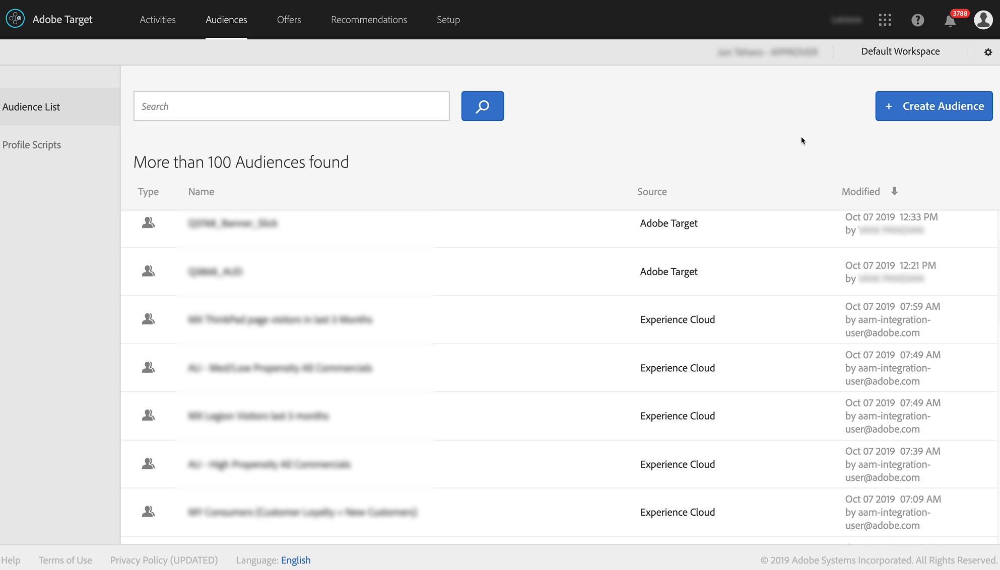

# 將Audience Manager與[!DNL Target]整合 {#integrate-audience-manager-with-target}

此整合可讓您將Audience Manager區段傳送至Adobe [!DNL Target]。

Audience Manager - [!DNL Target]整合需要：

* [Experience Cloud服務](https://experienceleague.adobe.com/docs/id-service/using/home.html?lang=zh-Hant)。 如果您未使用此服務，請參閱[實作指南](https://experienceleague.adobe.com/docs/id-service/using/implementation/implementation-guides.html?lang=zh-Hant)以開始使用。
* [!DNL Profiles and Audiences]. 如果您尚未布建[!DNL Profiles and Audiences]，請聯絡客戶服務以開始使用。

您在實作程式中完成這些步驟後，所有Audience Manager區段很快都會出現在[!DNL Target]中。 檢視&#x200B;**[!UICONTROL Audiences > Audience List]**&#x200B;以檢視[!DNL Target]中的Audience Manager區段。 依&#x200B;**[!UICONTROL Source]**&#x200B;欄中的Experience Cloud和&#x200B;**[!UICONTROL Modified]**&#x200B;欄中的`aam-integration-user@adobe.com`識別Audience Manager區段。

