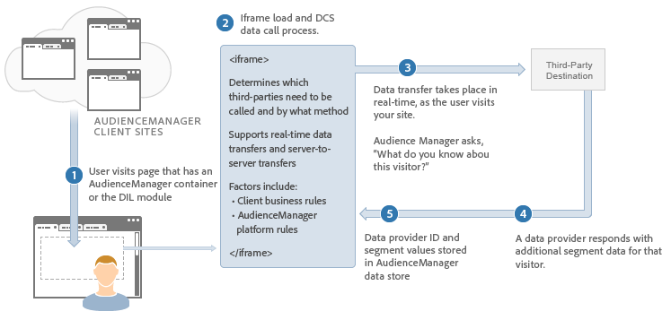

# 即時資料傳輸流程說明{#real-time-data-transfer-process-described}

概述Audience Manager如何與協力廠商內容提供者執行即時資料傳輸。

<!-- real-time-data-transfer-explained.xml -->

## 即時資料傳輸

即時資料傳輸會在使用者造訪您的網站或在您的網站上採取動作時，傳送及接收區段ID。 通常，當您需要立即讓使用者在瀏覽您的詳細目錄時符合資格或劃分使用者時，同步資料傳輸會很有用。

## 資料整合步驟

即時資料整合程式的運作方式如下：

1. 使用者造訪包含Audience Manager程式碼的客戶網站。
1. Audience Manager載入iframe並呼叫[!UICONTROL Data Collection Server] ( [!DNL DCS])。
1. [!DNL DCS]會呼叫協力廠商伺服器（即時）以檢查廠商是否有任何關於使用者的區段資訊。
1. 內容提供者會將該使用者的相關區段資訊傳回給Audience Manager。
1. Audience Manager會收到此區段資訊，並可用於鎖定和建立新特徵和區段。

