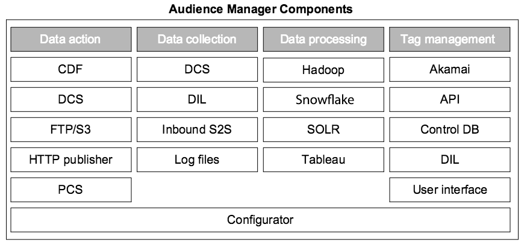

# Audience Manager系統中的關鍵元件{#key-components-in-the-audience-manager-system}

Audience Manager將其系統和流程分組為四個主要類別：標籤管理、資料收集、資料組織和資料可操作性。

<!-- 

c_compstack.xml

 -->

下圖顯示主要元件和支援[!DNL Audience Manager]的基礎技術（硬體和軟體）。 雖然有些流程會執行特定功能，而其他流程則具有多用途角色，但所有系統都會共同作業，協助您管理標籤、收集資料、分析效能、與其他系統同步資訊，以及針對該資訊採取行動。

